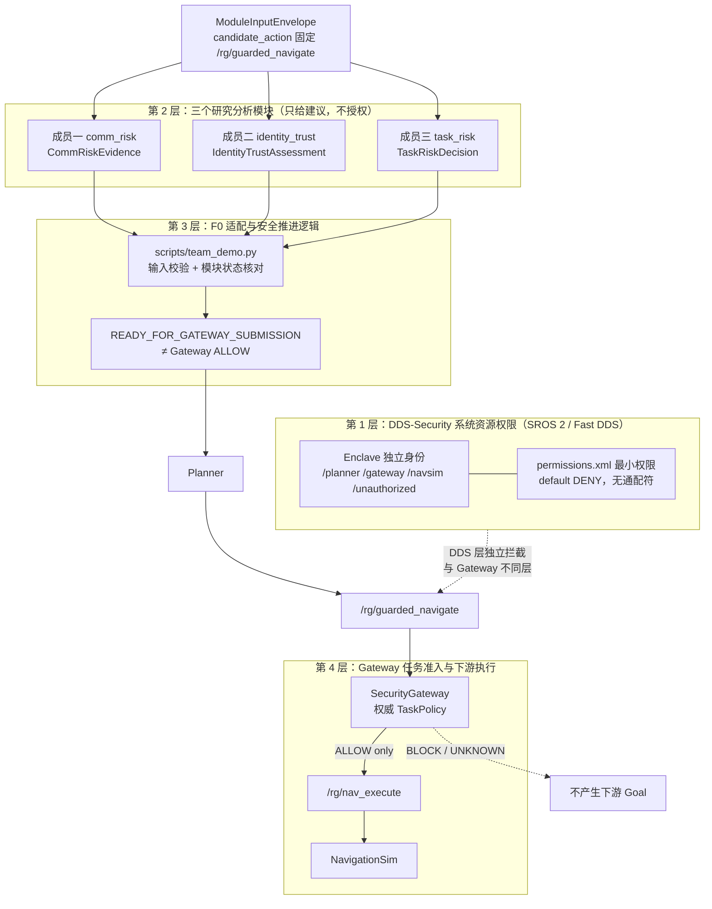

# 三成员代码审查与系统研发状态交接报告

> 本报告是 RosSystem 项目截至 **2026-10-16** 的事实基准，可直接作为 ChatGPT
> 后续研发、集成规划与竞赛材料撰写的事实依据。阅读第十二章即可建立完整上下文。

---

## 第一章：报告元数据

| 项 | 值 |
| --- | --- |
| 审查日期 | 2026-10-16（UTC） |
| 项目名称 | 面向具身智能机器人的 ROS 2 通信可信分析与动态最小权限防护系统 |
| 仓库 | `https://github.com/godzwp117/RosSystem` |
| 本地工程 | `/home/zhangwei/project/RosSystem` |
| **公共 baseline SHA** | **`a4c597161d254192b662ee7b8f4d17f76a89cc16`**（本轮 `git ls-remote` 复核未变化） |
| `origin/main` | `838f66f41821edf0421612a205d162ae8e9eb955` |
| 交付归档快照 | `chore/member-deliveries` = `3ce820258c69b89e2ad9291e16c44dc7d2b99150` |
| 契约状态 | **`PROPOSED_V1`** / `1.0.0-proposed`（**未冻结**） |
| 运行时 | WSL2 / Ubuntu 24.04 容器 `rg_jazzy`（`ros:jazzy`）/ ROS 2 Jazzy / `rmw_fastrtps_cpp` / Domain 42（普通）、43（Enforce） |
| 宿主 Python | 3.10.12（`.research-venv`：pytest 9.1.1、jsonschema 4.26.0）；容器内 jsonschema 4.10.3 |
| 报告生成者 | 研发审计智能体（本轮独立执行） |
| 审查范围 | 三成员交付源码、测试、实验数据；公共 baseline 契约与适配层；单模块与联合验收 |
| **未审查范围** | M1 的 ROSPaCe 全量重训（25G 数据，未执行）；M3 动态任务状态机分支；L3 三模块全真实在线联调 |

### 证据可信级别（本报告采用的标注体系）

| 级别 | 含义 |
| --- | --- |
| `E1_CODE` | 真实源码存在 |
| `E2_STATIC` | 静态审查证据 |
| `E3_UNIT_TEST` | 本轮单元测试执行结果 |
| `E4_INTEGRATION_TEST` | 本轮集成测试执行结果 |
| `E5_RUNTIME` | 真实 ROS 2 / DDS-Security 运行证据 |
| `E6_RESEARCH` | 数据集、模型、划分、指标可复核证据 |
| `HISTORICAL_REPORTED` | 历史报告声称通过，本轮**未**复测 |
| `UNVERIFIED` | 无法验证 |

**使用规则**：级别不代表可自动覆盖。源码存在不等于算法有效；权限文件允许不等于认证成功；
Schema 通过不等于结论可信；Gateway ALLOW 不等于下游必然执行。

---

## 第二章：系统整体架构

### 2.1 四层安全控制关系



### 2.2 两条独立安全边界（必须区分）

| 边界 | 作用层 | 拒绝表现 | 证据形式 |
| --- | --- | --- | --- |
| **DDS-Security** | 通信/资源层 | Fast DDS 原生 `not found in allow rule`，Action 客户端创建失败 | 原生日志 + 正向对照 |
| **SecurityGateway** | 应用/任务层 | `DecisionEvent` 决策 `BLOCK` + 原因码 | 审计 JSONL |

**DDS 允许 ≠ Gateway 允许；Gateway ALLOW ≠ NavigationSim 执行成功。** 三者须分别记录三种证据：
`DecisionEvent`、Action `Result`、NavigationSim `navsim_goals.jsonl` 行数。

### 2.3 数据流与决策流

```text
候选任务 → ModuleInputEnvelope(Schema 固定 action_resource=/rg/guarded_navigate)
        → 三模块各自 stdin/stdout 单 JSON
        → team_demo 校验输入/输出 Schema、request_id/run_id 一致性、状态门槛
        → 三者均为推进状态 → Planner → /rg/guarded_navigate
        → Gateway 权威 TaskPolicy 判定 → ALLOW → /rg/nav_execute → NavigationSim
```

**安全控制权归属**：研究模块**无**授权权；适配层只有**阻断**权，没有放行权；
唯一放行权在 SecurityGateway。

---

## 第三章：四名成员的真实研发状态

| 成员 | 主责 | 实际算法 | 已完成代码 | 测试状态（本轮实跑） | F0 接口 | 集成状态 | 主要问题 |
| --- | --- | --- | --- | --- | --- | --- | --- |
| **成员一** | ROS 2 通信行为可信分析与异常检测 | **ROPaCe 49 特征 + 类别权重 LogisticRegression / ExtraTrees 二分类**；导出为纯数值 JSON 模型（非 pickle） | `modules/my_comm/`：`module.py` / `train.py` / `data.py` / `metrics.py` / `features.json` 等 11 个 .py | **44 passed**（`test_module.py` 36 + `test_integration.py` 8） | `comm_risk` / `CommRiskEvidence` ✅ 可产生合法输出 | **不可运行（缺模型产物）**；模块本身可执行且失败关闭 | ①交付不含数值 JSON 模型，只有 joblib；②检测效果低于恒预测攻击基线；③仅覆盖 1 类攻击 |
| **成员二** | DDS 身份、资源权限与通信可信性分析 | **离线受控实验证据解释器**：源策略 XML + 生成 permissions.xml + 归档 Enforce 日志三方交叉核验 | `identity_trust/assessor.py`（333 行）+ `scripts/member2_adapter_check.py` | **23 passed** | `identity_trust` / `IdentityTrustAssessment` ✅ | 真实验收 **45 PASS / gate True** | ①非在线认证器（设计如此）；②`--case` 由可信配置固定；③对当前候选入口恒 UNKNOWN |
| **成员三** | 应用层任务风险分析与任务感知安全建议 | **确定性可解释规则引擎**（`TASK_CONSTRAINT_RULES_V1`）：任务 ID / 坐标系 / 目标区域 / 可选 Gateway 审计历史 | `modules/member3_taskrisk/module.py` + `risk_model.py`（286 行） | **95 passed** | `task_risk` / `TaskRiskDecision` ✅ | 真实验收 **45 PASS / gate True**；联合链路已验证 | ①原始交付配置下四状态不兼容旧验收器（已由验收器扩展解决）；②实时监测 NOT_READY |
| **成员四** | 框架与集成（F0） | 非算法：契约、适配层、Gateway、DDS 安全配置、环境隔离 | 4 个 ROS 2 包 + `scripts/team_demo.py` + `scripts/check_member_module.py` + 4 个公共 Schema | 全量单元测试 **575 passed / 3 skipped** | 不适用（F0 即适配层） | **已运行验证**（Gateway A/B 8/8、SROS2 Enforce 7/7） | 见第九章 |

### 3.1 关于交付来源的重要澄清

**任务书预期的 `feature/member1-comm` / `feature/member2-identity` / `feature/member3-taskrisk`
三个分支在本仓库中均不存在。** 实际可访问来源如下：

| 成员 | 实际来源 | 版本判定依据 |
| --- | --- | --- |
| 成员一 | `deliveries/member1-comm/`（归档）与本地 ZIP 解包 `user/RosSystem-member1-delivery(1)/` | **两副本归一化行尾后逐字节相同**（deliveries 用 LF，ZIP 用 CRLF）；无版本歧义，审查对象为 `deliveries/member1-comm` |
| 成员二 | `deliveries/member2-identity/`（与 `user/RosSystem_Member2_DDS_Identity_Delivery/` 同源） | 交付说明声明基线 `a4c5971` |
| 成员三 | `deliveries/member3-taskrisk/`（`MANIFEST.json` 12/12 sha256 本轮**校验通过**） | `packaging_change_only: true`、`module_version 0.1.0` |

成员一自述 `head_sha=21f528085ebe6d6a9df9e15c6c82c6465c80c84a`、`branch=feature/member1-comm-offline-baseline`，
**该提交不存在于本仓库与远程**（`git cat-file` 失败、`ls-remote` 无匹配）。
因此成员一的工作**只以归档形式存在**，无 Git 可追溯提交。

### 3.2 关于 ROSPaCe 相关分支的澄清

`origin/feature/rospace-dataset-adapter` 含 `modules/rospace_comm/`（`train.py`/`predict.py`/`f0_adapter.py`），
与成员一 `deliveries/member1-comm/modules/my_comm/` **是两套不同实现**。
按任务书要求，**不**将其认定为成员一最终交付。经查该分支产物为 `model.joblib` 路线，
而成员一交付实现**明确拒绝 joblib**（见第四章），二者为不同代际方案。

---

## 第四章：成员一技术审查

### 4.1 算法与实现（`E1_CODE`）

| 项 | 实测值 |
| --- | --- |
| 算法名 | 未命名；实现标识 `algorithm='numeric-model'`，模型格式 `member1-numeric-v1` |
| 方法 | **监督学习二分类**，两种候选：带类别权重 `LogisticRegression` 与 `ExtraTrees`（固定参数） |
| 输入 | `observations[].detail.rospace_comm.features` = `{feature_names:[...], values:[...]}`，**必须显式给出精确有序列名** |
| 特征维度 | **49**（源数据 61 个非标签字段，经可采集性清单筛选） |
| 数据集 | ROSPaCe 官方合集：`ROSPaCe_reduced`（15 分片）、`ROSPaCe_reduced_noperiodicity`（10 分片） |
| 划分 | **FILE_DISJOINT_SPLIT**：末 2 分片测试、前 2 分片验证、其余训练；按分片数字排序，不交叉 |
| 数据泄漏防护 | 模型特征名禁止 `attack/label/target/timestamp/session_id/group_id`；推理期再次拒绝这些键 |
| 缺失值 | 存在的 `null` 按**训练集拟合中位数**填补并记录数量；缺列不补 0 |
| 标准化 | signed-log + StandardScaler，**只在训练集拟合**，验证/测试固定 |
| 阈值 | 仅在验证集网格选择，选定后**一次性**评估测试集（不用测试集调参） |
| 模型产物 | **纯数值 JSON**（`load_model` 拒绝 pickle/joblib，只用 `json.loads` + SHA256 校验） |
| 推理一致性 | 提供 `numeric_export_parity` 校验：JSON 模型与 sklearn 概率最大误差 ~3.3e-16、分类不一致 0 |

### 4.2 安全设计（`E2_STATIC`，实现质量较高）

| 防护 | 实现位置 | 说明 |
| --- | --- | --- |
| 无反序列化风险 | `module.py:64` `strict_json(raw)` | 只解析 JSON，**不加载 pickle/joblib**，从根源消除不可信模型反序列化 |
| 模型路径限定 | `module.py:56` | 必须位于仓库 `training_runs/` 内，否则拒绝 |
| 模型完整性 | `module.py:61-63` | SHA256 不匹配即拒绝 |
| 模型大小上限 | `module.py:58` `MAX_MODEL=32MB` | 防止超大输入 |
| 模型结构校验 | `module.py:65-108` | 特征名唯一性/长度、树子节点索引、概率范围逐项校验 |
| 严格 JSON | `module.py:23-33` | 拒绝重复键与非有限数 |
| 标签不参与推理 | `module.py:162-163` | `analyse()` 明确忽略 `f0_mock`、业务标签与期望状态 |
| 失败关闭 | `module.py` `main()` | 缺模型 exit 3；非法信封 exit 2；缺真实资源/窗口 exit 4 |
| 不臆造攻击子类 | `module.py:189-190` | 检出异常只报 `SUSPICIOUS` + 类别 `UNKNOWN` |

### 4.3 实验指标（`E6_RESEARCH`，来自交付归档，本轮未重训）

| 指标 | reduced | noperiodicity |
| --- | --- | --- |
| 选定算法 | extra_trees | extra_trees |
| 阈值 | 0.75 | 0.75 |
| 测试样本 | 20000 | 20000 |
| TP / FP / FN / TN | 962 / 0 / 12741 / 6297 | 7184 / 0 / 8273 / 4543 |
| Precision | 1.0 | 1.0 |
| Recall | **0.0702** | **0.4648** |
| Specificity | 1.0 | 1.0 |
| F1 | **0.1312** | **0.6346** |
| Balanced Accuracy | 0.5351 | 0.7324 |
| **恒预测攻击 F1 基线** | **0.8132** | **0.8719** |
| 验证门槛 | **FAIL** | **FAIL** |
| 测试集攻击类别 | 仅 1 类（metasploit SYN flood） | 仅 1 类（同） |
| 漏报率 | **93.0%** | **53.5%** |

**结论（必须如实表述）**：

1. **F1 显著低于恒预测攻击基线** —— 该二分类器在当前测试集上**不具备实用检测价值**，
   甚至不如"全部判为攻击"的平凡策略。
2. `precision=1.0` 与 `recall=0.07` 并存，说明模型极度保守（几乎不报攻击），
   本质接近"恒预测正常"的退化行为。
3. **测试集只覆盖 6 类攻击中的 1 类**，无法支撑"多类攻击检测能力"表述。
4. 成员一**自己如实声明了这一点**：`model_performance_gate=FAIL`、`L3_effective_detector=NOT_READY`、
   `RUNTIME_MONITOR=NOT_READY`，并在 README 中写明旧 `F1=0.1967/Recall=0.1091` 只是基线指引、
   被证伪的 `0.9956` 不作为实绩。**这是诚实交付，不是隐瞒。**

### 4.4 可运行性实测（本轮 `E4_INTEGRATION_TEST`）

| 测试 | 命令 | 结果 |
| --- | --- | --- |
| 交付自带单测 | `pytest modules/my_comm/test_module.py` | **36 passed** |
| 交付自带集成测 | `pytest modules/my_comm/test_integration.py` | **8 passed** |
| 真实模块运行（正确落位 + joblib 模型） | `module.py --model training_runs/.../model.joblib` | **exit 0，status=ERROR**，`MODEL_INVALID: 'utf-8' codec can't decode byte 0x80` |

**关键发现（P1）**：`training_runs/` 下**只有 `model.joblib` / `scaler.joblib`**，
**不存在**成员一交付实现所需的 `member1-numeric-v1` JSON 模型。
因此**成员一的模块在当前工作区无法完成一次真实推理**，只能失败关闭为 `ERROR`。
数据源仍在（`data/ROSPaCe_reduced/` 25G），**可通过重训该交付版本的 `train.py` 重新导出 JSON 模型**。

**次要不一致（P3）**：`deliveries/member1-comm/modules/my_comm/module.py:13` 使用
`ROOT = HERE.parents[1]`。在成员一原生布局（交付 ZIP 内是**完整仓库快照**，
模块位于 `<repo>/modules/my_comm/`）下该式正确；但归档把文件搬到
`deliveries/member1-comm/modules/my_comm/` 后 `ROOT` 变成 `.../modules`，
`sys.path` 注入失败。**这不是算法缺陷**，而是"归档重定位后不可直接运行"的打包问题，
应在落位到 `modules/<name>/` 后运行（本轮已按此验证通过）。

### 4.5 在线性判定

| 能力 | 状态 |
| --- | --- |
| OFFLINE_TRAINING | **已完成**（实验报告齐全） |
| OFFLINE_INFERENCE | **代码已实现**，但缺 JSON 模型，本轮**未能演示**；交付自带集成测试用受控数值模型通过 |
| CONTROLLED_REPLAY | **有证据**（`artifacts/member1/ros_controlled_protocol/`，`E4`/`HISTORICAL_REPORTED`） |
| ONLINE_FEATURE_COLLECTION | **尚无证据**（无 ROS 2 订阅采集代码） |
| ONLINE_INFERENCE | **无** |
| REALTIME_RUNTIME_MONITORING | **NOT_READY**（模块自身输出亦如此声明） |

**判定：成员一是离线数据分类器原型，不是实时 ROS 2 入侵检测器。** 不得如此宣称。

---

## 第五章：成员二技术审查

### 5.1 信任判断方法（`E1_CODE`）

**这是离线受控实验的证据解释器（advisory evidence interpreter），不是在线 DDS 身份认证器。**
其 `assessment()` 执行三方交叉核验：

1. **源策略** `security/policies/minimal_permissions.xml` —— `policy_permits()`
2. **生成的 DDS 权限** `security/keystore/enclaves/<role>/permissions.xml` —— `permission_permits()`
3. **归档的受控 Enforce 实验日志** —— `checked_case()` + 客户端原始日志

并要求三者**互相一致**：源策略与生成权限不一致 → `UNKNOWN`；摘要/日志/权限任一不可信 → `UNKNOWN`。

### 5.2 逐项核对（对应任务书 6.2 的 13 问）

| # | 问题 | 实测结论 |
| --- | --- | --- |
| 1 | 信任判断方法 | 配置推导 + 运行时日志证据的交叉核验，非在线认证 |
| 2 | 输入来源 | 受信任 CLI 配置（`--policy/--keystore/--evidence-root/--experiment-run/--case`）+ stdin 信封；**不**从业务 JSON 取路径 |
| 3 | 是否读取真实 Permissions | **是**（读取生成的 `permissions.xml`，不读私钥） |
| 4 | 资源权限映射 | **是**：DDS service request = publish `rq/<svc>Request` + subscribe `rr/<svc>Reply`，两者须在同一 `allow_rule` |
| 5 | 身份与 Enclave 可信关联 | **无**。不填 `subject.authenticated_identity`，从不把 `request_id`/`declared_enclave` 当已认证身份 |
| 6 | 能否区分配置允许 vs 实际成功 | **能**：两者不一致即 `UNKNOWN` |
| 7 | 能否区分配置拒绝 vs DDS 实际拒绝 | **能**：`DENIED` 必须有原生 `not found in allow rule` 日志（不是超时） |
| 8 | 是否使用真实 SROS 2 Enforce 结果 | **是**（归档域 43 Enforce 实验；本轮另有新生成的同源证据） |
| 9 | 是否正反对照 | **是**：S3/S4 拒绝必须依赖同 run 的 S3C 正向对照成功 |
| 10 | 证据不足是否 UNKNOWN | **是**（缺 run/日志/对照/权限矛盾全部失败关闭） |
| 11 | 错误是否安全失败 | **是** |
| 12 | 是否产生合法 Output | **是**（Schema 校验通过，本轮实测） |
| 13 | 是否接入 F0 | **是**（真实验收 45 PASS / gate True） |

### 5.3 禁止作为身份证明的字段（实测确认未被使用）

`request_id`、JSON 自报身份、Mock 输出、自定义字符串 `AUTHORIZED`、ROPaCe 攻击标签
—— 以上均**不**被成员二用作 DDS 身份认证依据。有专门测试
`test_request_id_not_identity` / `test_untrusted_observations_cannot_escalate` 覆盖。

### 5.4 关键安全语义（本轮实测）

| 场景 | 证据层 | 评估层 | 说明 |
| --- | --- | --- | --- |
| S2（`/planner`→`/rg/guarded_navigate`） | `AUTHORIZED` | **`AUTHORIZED`** | 资源与当前候选入口一致 |
| S3C（`/gateway`→`/rg/nav_execute`） | `AUTHORIZED` | **`UNKNOWN`** | 资源不同，不得搬运 |
| S3（`/planner`→`/rg/nav_execute`） | **`DENIED`** | **`UNKNOWN`** | 原生拒绝证据保留；资源不同不得搬运 |
| S4（`/unauthorized`→`/rg/nav_execute`） | **`DENIED`** | **`UNKNOWN`** | 同上 |

**必须理解的要点**：`AUTHORIZED` 只表示**所引用的历史实验中访问成功**，
**不证明当前请求已完成 DDS 认证**，也不代表 Gateway 授权。

### 5.5 安全风险

| ID | 问题 | 级别 |
| --- | --- | --- |
| — | **NO_CONFIRMED_CRITICAL_FINDINGS** | — |
| R-1 | `event_id` 与 Schema 的 128 字符上限存在契约张力（`request_id` > 80 字符时无法同时满足"含完整 request_id"与"≤128"） | P2 |
| R-2 | 对当前候选入口（`/rg/guarded_navigate`）恒为 `UNKNOWN`，因为现有受控实验只覆盖 `/rg/nav_execute` | P2（符合安全要求，非缺陷） |

### 5.6 最终评价

成员二交付了一个**边界表述准确、防护完整、失败关闭可靠**的离线证据解释器。
它**没有**把自己包装成在线身份认证模块，`--case` 由可信配置固定而非业务输入，
且明确拒绝把历史判定搬运到当前请求。**建议接入**（已通过真实验收）。

---

## 第六章：成员三技术审查

### 6.1 风险推理方法（`E1_CODE`）

**确定性可解释规则引擎**，标识 `TASK_CONSTRAINT_RULES_V1`，声明 `authority=ADVISORY_ONLY`。
非评分模型、非状态机、非统计模型。入口 `infer(envelope, settings, now)`。

### 6.2 风险因子及来源

| 风险因子 | 来源 | 违反时原因码 |
| --- | --- | --- |
| 任务 ID 匹配 | `candidate_action.task_id` vs TaskPolicy `task_id` | `TASK_MISMATCH` |
| 坐标系匹配 | `candidate_action.target.frame_id` vs `coordinate_frame` | `INVALID_TARGET` |
| 目标有限性 | `target.x/y/z` 必须有限 | `INVALID_TARGET` |
| 目标区域 | `allowed_region` 闭区间，计算 signed boundary margin | `OUT_OF_REGION` |
| 策略是否生效 | `active` 字段 | `POLICY_MISSING` |
| 请求标识非空 | `request_id.strip()` | `INVALID_TARGET` |
| 重复请求 | **可选**可信 Gateway 审计历史（去重窗口） | `DUPLICATE_REQUEST` |
| 速率限制 | 同上（滑动 60 秒准入次数） | `RATE_LIMIT` |

### 6.3 审计历史处理的安全边界（实测符合要求）

| 要求 | 实现 |
| --- | --- |
| 历史快照不得冒充 Gateway 并发状态权威 | `pending_gateway_checks` 保留 `CONCURRENT_TRACKER_RECHECK`；`clock_basis='wall-clock snapshot; not Gateway monotonic tracker'` |
| 历史不完整必须失败关闭 | `HistoryUnavailable`（缺失/过期/撕裂行/配对不全/时间越界）→ `UNKNOWN`；`HistoryInvalid`（JSON 非法/重复/关联错位）→ `ERROR` |
| 去重/速率不得冒充实时权威判定 | 输出 `authority=ADVISORY_ONLY`，`DUPLICATE_REQUEST`/`RATE_LIMIT` 仍标为待 Gateway 复核 |
| 不得为实验成功改 Gateway 规则顺序 | `src/` 零改动（本轮 `git diff` 为 0） |

### 6.4 Gateway 边界验证（本轮 `E4`/`E5` 实测）

| 检验 | 命令 | 结果 |
| --- | --- | --- |
| 合法任务→仅 READY | `team_demo --config member3.real`（合法输入） | `READY_FOR_GATEWAY_SUBMISSION`，`gateway_decision=None`、`navsim_goal_id=None` |
| **越界时 M3 建议阻断** | 同上，目标 (9.0,9.0) | M3 `BLOCK_RECOMMENDED` → `ADAPTER_BLOCK` / `ADAPTER_MODULE_STATUS_NOT_PROCEED` |
| **Gateway 独立阻断越界** | `run_demo.sh` 场景 B | Gateway `BLOCK`/`OUT_OF_REGION`，NavigationSim **+0 Goal**，无 `ExecutionEvent` |
| 是否绕过 Gateway 直连执行端 | 静态审查 | **未发现**：`module.py` 无 ROS import、无 Action client、无 socket；仅 stdin→stdout |

**关键安全命题已验证**：当成员三与适配层都倾向放行时，
**Gateway 仍能独立阻断超界任务**（场景 B 中 Planner 走完整 Action 链，网关权威拒绝）。

### 6.5 实验与误报漏报

- 交付 `reports/offline_report.json` 记录 87/87 自建受控策略场景正确（`HISTORICAL_REPORTED`，本轮未复跑）。
- 本轮四状态真实验收：`allow→ALLOW_RECOMMENDED`、`block→BLOCK_RECOMMENDED`、
  `unknown→UNKNOWN`、`error→ERROR`，**无误报/漏报**（在受测场景内）。
- 解释性：输出 `rule_basis` 列出全部违反条款及 `policy_field`，可解释性良好。

### 6.6 M3 依赖澄清

**不依赖** `feature/m3-dynamic-policy` 的动态任务状态机。模块自述
`dynamic_state_model = "NOT_INTEGRATED"`、`runtime_monitor = "NOT_READY"`。
该独立分支与 baseline **互不包含**，本轮未审查其算法。

### 6.7 最终评价

成员三交付了一个**真实算法、失败关闭、可解释、不越权**的规则引擎，
且**未**为了通过测试而修改 Gateway 权威策略或降低门槛。
**建议接入**（已通过真实验收与联合链路验证）。

---

## 第七章：跨模块兼容性与安全集成

### 7.1 接口兼容矩阵

| 项 | 成员一 | 成员二 | 成员三 | 兼容性 |
| --- | --- | --- | --- | --- |
| 输入 | `ModuleInputEnvelope` 1.0.0-proposed | 同 | 同 | ✅ |
| 输出 Schema | `comm_risk_evidence` | `identity_trust_assessment` | `task_risk_decision` | ✅ 三者独立 |
| 状态枚举 | `NORMAL/SUSPICIOUS/UNKNOWN/ERROR` | `AUTHORIZED/DENIED/UNKNOWN/ERROR` | `ALLOW_RECOMMENDED/BLOCK_RECOMMENDED/UNKNOWN/ERROR` | ✅ |
| 推进状态（唯一） | `NORMAL` | `AUTHORIZED` | `ALLOW_RECOMMENDED` | ✅ 定义于 `team_demo.PROCEED_STATES` |
| 协议 | stdin 单 JSON → stdout 单 JSON，诊断走 stderr | 同 | 同 | ✅ |
| 退出码语义 | 0 成功；2 非法信封；3 缺模型；4 缺证据 | 0（含 UNKNOWN）；2 非法信封 | 0（含阻断）；2 非法输入；4 内部失败 | ⚠️ **不一致**（见 P2-2） |
| `event_id` 含 `request_id` | 不适用 | ✅（本轮修复后） | ✅ | ✅ |
| 契约版本 | `1.0.0-proposed` | 同 | 同 | ✅ 无 Schema 改动需求 |

### 7.2 配置与依赖兼容矩阵

| 项 | 成员一 | 成员二 | 成员三 | 备注 |
| --- | --- | --- | --- | --- |
| Python | 3.11（README 声明） | 标准库 + jsonschema | 3.10+ | ⚠️ 宿主为 3.10.12，M1 声明 3.11；本轮 M1 测试在 3.10 通过 |
| 第三方依赖 | numpy 等（训练）；**推理仅标准库+jsonschema** | **仅标准库 + jsonschema** | PyYAML + jsonschema | 推理期依赖轻 |
| jsonschema | ≥4.0（Draft 2020-12） | 未强制 | ≥4.0 | ⚠️ 宿主系统 `python3` 仅 3.2.0（P2-1） |
| ROS 2 | 仅在线协议实验需要 | **不需要** | **不需要** | M2/M3 可纯离线运行 |
| ROS_DOMAIN_ID | 受控实验用 51（成员档位） | 证据涉及 42/43 | 不涉及 | ✅ 与 baseline 42/43 不冲突 |
| 容器 | 可用既有 `rg_jazzy` | 同 | 同 | ✅ |
| 数据来源 | ROSPaCe 离线 CSV | SROS 2 归档日志 + 权限 XML | TaskPolicy + Action 请求 | 相互独立 |

### 7.3 单模块替换测试（本轮实测）

| 配置 | 合法输入 | 越界输入 | 说明 |
| --- | --- | --- | --- |
| 全 MOCK（基线默认） | 34 PASS / gate True | — | 基线行为 |
| **仅成员二 EXTERNAL** | 45 PASS / gate True | — | M1/M3 仍 MOCK |
| **仅成员三 EXTERNAL** | `READY_FOR_GATEWAY_SUBMISSION` | `ADAPTER_BLOCK`（M3 `BLOCK_RECOMMENDED`） | M1/M2 仍 MOCK |
| 仅成员一 EXTERNAL | **未能执行**（缺 JSON 模型，P1） | — | 见 §4.4 |
| 三模块全 EXTERNAL | **未执行** | — | 因 M1 缺模型，本轮无法进行 |

### 7.4 当前实际可运行的最完整系统形态

**`成员三 EXTERNAL + 成员一/二 MOCK`**，且已验证：
该形态下 Gateway/NavigationSim 链路（`run_demo.sh` 8/8 PASS）与
DDS-Security Enforce（域 43，S1–S6 7/7 PASS）均可运行。

**这是当前可复现的最完整形态，但它不是三模块全真实联合系统。**

### 7.5 DDS 安全实验（本轮 `E5` 实测）

| 项 | 结果 |
| --- | --- |
| 域 43 Enforce | **7 passed / 7 total** |
| 原生拒绝 | S3/S4 均含 Fast DDS `not found in allow rule`（含 ANSI 着色，2 条记录/场景） |
| 正向对照 | S3C `/gateway`→`/rg/nav_execute` 成功 |
| 最小权限核验 | 无通配符、`<default>DENY`、`/planner` 对执行端 **0** 授权、`/unauthorized` 业务 Action **0** 授权 |
| S6 静默回退 | **未发生**（缺 keystore 即初始化失败） |
| keystore | 复用既有（`ca.cert.pem` 存在），**未重建、未覆盖** |

### 7.6 跨模块实际冲突（已识别）

| ID | 冲突 | 影响 |
| --- | --- | --- |
| X-1 | **成员一无可用模型产物** | 三模块全真实联合**无法进行**；这是最大集成阻塞 |
| X-2 | 成员一模块要求落位 `modules/<name>/`（`parents[1]` 假设） | 归档重定位后不可直接运行，需按布局落位 |
| X-3 | 退出码语义不统一（见 §7.1） | 适配层不依赖退出码语义（仅"非零即失败"），当前不阻塞；但多模块组合时语义解释成本高 |
| X-4 | M2 对当前候选入口恒 `UNKNOWN` | 三模块全真实时，M2 会**持续阻断**推进（安全方向正确，但使"全真实联合"无法达成 READY） |

**X-4 值得特别说明**：即使成员一模型问题解决，只要 M2 保持当前语义，
`/rg/guarded_navigate` 候选请求在 M2 处仍会是 `UNKNOWN` → 适配层阻断。
这是一个**设计上的安全收紧**，不是缺陷；但"三模块全真实联合跑通到 Gateway"这一目标
需要先为候选入口补充受控安全实验，或由成员四确认该状态下的预期行为。

---

## 第八章：实际测试结果

| # | 测试 | 被测版本 | 执行命令 | 返回码 | 结果 | 证据级别 |
| --- | --- | --- | --- | --- | --- | --- |
| 1 | 契约与样例校验 | `fix/m2-m3-acceptance` @ `19f6a25` | `python3 scripts/validate_team_contracts.py --all` | 0 | **PASS**（10 合法 + 13 非法全部按预期） | `E4` |
| 2 | M1 自带单测 | `deliveries/member1-comm` | `pytest modules/my_comm/test_module.py -q` | 0 | **36 passed** | `E3` |
| 3 | M1 自带集成测 | 同上 | `pytest modules/my_comm/test_integration.py -q` | 0 | **8 passed** | `E3` |
| 4 | M1 真实模块运行 | 同上 | `module.py --model training_runs/rospace_reduced/model.joblib ...` | 0 | **ERROR**（`MODEL_INVALID`，缺 JSON 模型） | `E4` |
| 5 | M2 自带单测 | `deliveries/member2-identity` | `pytest tests/unit/test_identity_trust_assessor.py -q` | 0 | **23 passed** | `E3` |
| 6 | M2 真实验收 | `config/team_modules.member2.real.yaml` | `check_member_module.py --module identity_trust --real-fixture ...` | 0 | **45 PASS / gate True** | `E4` |
| 7 | M3 自带单测 | `deliveries/member3-taskrisk` | `pytest tests/unit/test_member3_taskrisk.py -q` | 0 | **95 passed** | `E3` |
| 8 | M3 真实验收 | `config/team_modules.member3.real.yaml` | `check_member_module.py --module task_risk --real-fixture ...` | 0 | **45 PASS / gate True** | `E4` |
| 9 | M3 原始交付配置 | `config/team_modules.member3.yaml` | 同上（不带 fixture） | 0 | **33 PASS / 3 FAIL / gate False** | `E4` |
| 10 | 联合：仅 M3 真实（合法） | 容器内 | `team_demo.py --input module_input_valid.json --config member3.real` | 0 | **READY_FOR_GATEWAY_SUBMISSION** | `E4` |
| 11 | 联合：仅 M3 真实（越界） | 容器内 | 同上 + 目标 (9,9) | 10 | **ADAPTER_BLOCK**（M3 `BLOCK_RECOMMENDED`） | `E4` |
| 12 | Gateway/NavigationSim A/B | `fix/m2-m3-acceptance` | `bash scripts/run_demo.sh` | 0 | **8 passed / 0 failed** | `E5` |
| 13 | DDS-Security Enforce S1–S6 | 同上 | `sros2_check.py --run-id audit20261016` | 0 | **7 passed / 7 total** | `E5` |
| 14 | 全量单元测试 | 同上 | `pytest tests/unit -q` | 0 | **575 passed / 3 skipped** | `E4` |
| 15 | DDS 权限独立核验 | 同上 | `verify_sros2_permissions.py --domain 43` | 0 | **PASS** | `E4` |
| 16 | 成员三 MANIFEST 完整性 | `deliveries/member3-taskrisk` | 逐文件 sha256 复核 | — | **12/12 OK** | `E2` |
| 17 | M1 离线实验指标 | `deliveries/member1-comm` | 读取报告并独立重算 | — | **gate FAIL，F1 < 基线** | `E6` |

### 历史未复测项（`HISTORICAL_REPORTED`，不得计入本轮 PASS）

| 项 | 历史声称 | 本轮状态 |
| --- | --- | --- |
| M1 离线训练复现 | `L2_offline_experiment=PASS` | **未重训**（25G 数据，未执行） |
| M1 Jazzy 在线协议 | `Jazzy_tests=203_PASSED`、`L3_live_protocol=PASS_WITH_CONTROLLED_FIXTURES` | **未复跑**（本轮 M1 测试为 44 项） |
| M3 87/87 受控场景 | `reports/offline_report.json` | **未复跑** |
| M3 `generic_acceptance_report` | 33 PASS / 3 FAIL / gate False | **本轮已复现**（#9 一致） |
| M2 SROS 2 历史实验 | `exports/m2_sros2_enforce` 7/7 | 本轮另有同源新实验（#13）通过，历史目录**未改动** |

---

## 第九章：代码缺陷与系统风险

### P0（安全边界失效 / 危险放行）

**NO_CONFIRMED_CRITICAL_FINDINGS**

本轮未发现：越界请求实际创建下游 Goal；DDS Enforce 权限意外宽松；
正向对照或原生拒绝证据不成立；UNKNOWN/ERROR 被错误放行；成员模块绕过 Gateway。

### P1（影响集成或结果真实性）

| ID | 问题 | 文件/位置 | 触发条件 | 影响 | 修复建议 |
| --- | --- | --- | --- | --- | --- |
| **P1-1** | **成员一交付不含可加载的数值 JSON 模型**；`training_runs/` 仅有 `model.joblib`/`scaler.joblib`，而交付实现只接受 `member1-numeric-v1` JSON | `deliveries/member1-comm/modules/my_comm/module.py:64` + `training_runs/*/` | 以任何 joblib 作为 `--model` 运行 | 模块无法完成真实推理，只能 `ERROR` 失败关闭；**三模块全真实联合无法进行** | 用交付版 `train.py` 对现有 `data/ROSPaCe_reduced/`（25G，或 `noperiodicity` 版本）重训并导出 JSON 模型，连同其 SHA256 一并交付；**不要**把 joblib 塞给它 |
| **P1-2** | **成员一检测效果低于平凡基线**：F1 0.1312 / 0.6346 vs 恒预测攻击 0.8132 / 0.8719；门槛 FAIL；漏报率 93.0% / 53.5% | `deliveries/member1-comm/artifacts/member1/offline_experiments/summary.json` | 以现有模型对测试集推理 | 不能作为有效检测器；任何"已实现通信异常检测能力"的表述均不成立 | 不要为过关而调阈值或改测试集。应如实按"实验原型、性能门槛未达标"表述；若时间允许，优先排查特征/采样/类别不平衡，而非换模型堆指标 |
| **P1-3** | **测试集只覆盖 1 类攻击**（metasploit SYN flood） | 同上 `test.class_counts` | — | 无法支撑多类攻击检测结论；ROPaCe 其余攻击类未评估 | 在报告中显式标注"仅 1 类攻击已验证"；如需多类结论须重新划分并评估（未出现的类别标 `NOT_EVALUATED`） |

### P2（比赛提交前应解决）

| ID | 问题 | 依据 | 影响 | 建议 |
| --- | --- | --- | --- | --- |
| **P2-1** | 宿主系统 `python3` 仅 `jsonschema 3.2.0`，而真实模块需 ≥4.0（Draft 2020-12） | 实测：`python3 -c "import jsonschema"` → 3.2.0；容器内为 4.10.3 | 在宿主机直接跑 `team_demo.py` 会以 `ADAPTER_MODULE_EXIT_NONZERO` 失败 | 统一在容器内运行 F0/联调；或明确文档化所需解释器 |
| **P2-2** | 三模块**退出码语义不统一**（M1 用 2/3/4 表示不同失败；M2 用 2；M3 用 2/4） | 各自 `main()` | 适配层只按"非零即失败"处理，当前不阻塞；但跨模块诊断与合并验收解释成本高 | 在 `docs/interfaces/` 中约定统一退出码语义；不急于改代码 |
| **P2-3** | M2 对当前候选入口恒 `UNKNOWN` | §5.4 实测 | 三模块全真实时 M2 会持续阻断推进 | 为 `/rg/guarded_navigate` 补充受控安全实验，或由成员四确认该状态为预期 |
| **P2-4** | `event_id` 与 Schema 128 字符上限的契约张力 | 10-15 报告 R-1 | `request_id` 超 80 字符时无法同时满足"含完整 request_id"与"≤128" | 由成员四裁定：缩短随机后缀或放宽 Schema（需契约评审） |
| **P2-5** | PR #6 / #7 的 base 均为 `main`，而团队政策要求研究模块 PR 指向 `baseline`（仓库已有自动守卫检测此事） | GitHub API 实测；`tests/unit/test_member_module_contract.py` | 违反团队政策，存在误合入 `main` 风险 | `gh pr edit 6 --base baseline`、`gh pr edit 7 --base chore/member-deliveries`（PR #7 完整包含 PR #6，须按序合流） |

### P3（可后续处理）

| ID | 问题 | 说明 |
| --- | --- | --- |
| P3-1 | 成员一归档重定位后 `ROOT` 计算失配（`parents[1]`） | 原生布局正确；落位 `modules/<name>/` 即正常（本轮已验证） |
| P3-2 | 成员一 README 声明 Python 3.11，宿主为 3.10.12 | 本轮其 44 项测试在 3.10 通过；建议对齐声明 |
| P3-3 | `deliveries/` 内含 `__pycache__`（M2 目录） | 归档卫生问题，无功能影响 |
| P3-4 | 成员一 `deliveries` 归档无 Git 提交（`21f5280` 未推送） | 降低可追溯性；建议补推或保留归档哈希 |
| P3-5 | M3 原始交付配置在旧验收器下 3 项 FAIL | 属验收器场景注入机制不兼容，已由 `--real-fixture` 扩展解决；**非模块缺陷** |

---

## 第十章：当前系统真实完成度

### 10.1 能力矩阵

| 能力 | 代码实现 | 独立验证 | F0 接入 | ROS 2 实验 | 最终状态 |
| --- | --- | --- | --- | --- | --- |
| **DDS-Security 基础身份权限** | ✅ 已有 | ✅ `E4` 权限核验 PASS | ✅ | ✅ `E5` S1–S6 7/7 | **已验证** |
| **通信异常检测（成员一算法）** | ✅ 代码完整 | ✅ 44 项测试通过 | ⚠️ 接口可用但**缺模型** | ❌ 受限 | **PARTIAL / NOT_READY**（性能门槛 FAIL） |
| **身份信任评估（成员二）** | ✅ | ✅ 23 项 + 真实验收 45 PASS | ✅ | ✅ 使用真实 Enforce 归档 | **已验证（离线证据解释器）** |
| **任务风险推理（成员三）** | ✅ | ✅ 95 项 + 真实验收 45 PASS | ✅ | ✅ 联合链路已验证 | **已验证** |
| **外部模块协议适配（F0）** | ✅ | ✅ 576 项含契约测试 | ✅ | ✅ | **已验证** |
| **Gateway 任务准入** | ✅ | ✅ | ✅ | ✅ A/B 8/8 | **已验证** |
| **导航模拟执行** | ✅ | ✅ | ✅ | ✅ +1 Goal（合法）/+0（越界） | **已验证** |
| **动态最小权限** | ⚠️ 仅静态最小权限 | ✅ 静态权限核验 | ✅ | ✅ Enforce | **PARTIAL**（无动态调整能力） |
| **结构化安全审计** | ✅ | ✅ | ✅ | ✅ `DecisionEvent` 可关联 | **已验证** |
| **跨模块联合阻断** | ✅ 机制完备 | ✅ 单模块阻断已验证 | ✅ | ⚠️ 仅"M3 真实+2 MOCK" | **PARTIAL** |
| **真实 ROS 2 在线检测** | ❌ | ❌ | — | ❌ | **NOT_READY** |

### 10.2 分层完成度（不给出无依据的单一百分比）

| 层次 | 状态 | 依据 |
| --- | --- | --- |
| 系统基础（Action 主链 / Gateway / 审计 / 环境隔离） | **已完成并验证** | A/B 8/8、Enforce 7/7、576 项测试 |
| 三个算法模块 | **2 个可用 + 1 个不可用** | M2/M3 通过真实验收；M1 缺模型且性能不合格 |
| 跨层联动（模块→F0→Gateway→执行端） | **部分完成** | 单模块替换已验证；全真实联合**未执行** |
| 数据采集（在线） | **未实现** | 无 ROS 2 在线特征采集代码 |
| 安全防护（DDS + Gateway 双层） | **已完成并验证** | 两层独立验证通过 |

**若必须量化**：以"能力矩阵 11 项"计权（已验证 8、PARTIAL 3、NOT_READY 0 计），
得 `(8×1 + 3×0.5)/11 ≈ 86%`。**该数字的权重与取舍由本报告设定，含主观成分，
不构成对比赛完成度的承诺**；请以能力矩阵逐项表述为准。

---

## 第十一章：下一阶段集成与研发建议

### 11.1 可以立即集成

| 项 | 理由 |
| --- | --- |
| **成员三 `task_risk`** | 真实验收 45 PASS、联合链路已验证、不越权、不改 Gateway |
| **成员二 `identity_trust`** | 真实验收 45 PASS、边界表述准确、失败关闭可靠（注意其对候选入口恒 UNKNOWN 的语义） |
| **F0 验收器扩展（`--real-fixture`）** | 已通过 27 项反例测试，不放松原有门槛 |

### 11.2 必须修改后才能集成

| 项 | 前置条件 |
| --- | --- |
| **成员一 `comm_risk`** | 必须先用其交付版 `train.py` 重训并导出 **JSON 数值模型**（含 SHA256），再跑通四状态验收。**性能门槛 FAIL 不阻断"接入"但阻断"宣称有效检测"** |
| PR #6 / #7 合流 | 需先把 base 改为 `baseline` / `chore/member-deliveries`（无写权限，需有权限者操作） |

### 11.3 暂不建议集成

| 项 | 理由 |
| --- | --- |
| `feature/m3-dynamic-policy` 动态状态机 | 与 baseline 互不包含，本轮未审查其算法；且交付模块自述 `dynamic_state_model=NOT_INTEGRATED` |
| `feature/rospace-dataset-adapter` 的 `modules/rospace_comm` | 与成员一交付为不同代际实现，未经本轮审查 |
| 三模块全真实联合 | 待 P1-1 解决，且需先处理 X-4（M2 恒 UNKNOWN） |

### 11.4 公共契约需确认事项

| 事项 | 需谁确认 |
| --- | --- |
| 是否维持 `PROPOSED_V1` 不冻结 | 全员 + 成员四 |
| `event_id` 与 128 字符上限的张力（P2-4） | 成员二、成员三、成员四 |
| 统一退出码语义（P2-2） | 三位成员 + 成员四 |
| M2 对候选入口恒 UNKNOWN 是否为预期（P2-3） | 成员二 + 成员四 |

### 11.5 到 10 月 22 日前的优先工作（按投入产出排序）

1. **重训并交付成员一 JSON 模型**（P1-1）——这是唯一真正阻断"三模块全真实"的问题。
2. **修正 PR base 并完成合流评审**（P2-5）——影响交付合规性。
3. **统一运行环境**（P2-1）——把联调固定在容器内执行，避免假失败。
4. **补充 `/rg/guarded_navigate` 的 M2 受控实验**（P2-3）——否则全真实联合不可能达到 READY。
5. **如实撰写材料**：M1 标注为"实验原型、性能门槛未达标"；M2 标注为"离线证据解释器"；
   全系统标注为"M3 真实 + M1/M2 显式 MOCK 的受控链路"。

**明确不建议**：重写架构、重构成员算法、为提升指标而调阈值/改测试集、冻结契约。

---

## 第十二章：供 ChatGPT 继续研发使用的上下文摘要

> 以下内容可**直接复制**到新的 ChatGPT 对话中，作为项目事实基准。

### 项目状态摘要（截至 2026-10-16）

**1. 当前日期**：2026 年 10 月 16 日。作品提交节点 2026 年 10 月 22 日。

**2. 项目目标与定位**：面向具身智能机器人的 **ROS 2 通信可信分析与动态最小权限防护系统**。
定位是"**系统安全为基础，应用安全为核心，具身智能机器人为应用场景**"。
关注点不是机器人业务功能，而是"谁在通信、通信行为是否异常、该操作在当前任务下是否被允许"。

**3. 最新 baseline SHA**：`a4c597161d254192b662ee7b8f4d17f76a89cc16`（`origin/baseline`）。
`origin/main` = `838f66f41821edf0421612a205d162ae8e9eb955`。
交付归档 `chore/member-deliveries` = `3ce820258c69b89e2ad9291e16c44dc7d2b99150`。
修复/演示分支 `fix/m2-m3-acceptance` = `19f6a256e71db7270de88e5b76b9ac2d87668cc6`；
演示候选标签 `demo-2026-10-19-rc-preflight-20261016`。契约 `PROPOSED_V1 / 1.0.0-proposed`，**未冻结**。

**4. 四名成员职责**：
- 成员一：ROS 2 通信行为可信分析与异常检测（`comm_risk` / `CommRiskEvidence`）
- 成员二：DDS 身份、资源权限与通信可信性分析（`identity_trust` / `IdentityTrustAssessment`）
- 成员三：应用层任务风险分析与任务感知安全建议（`task_risk` / `TaskRiskDecision`）
- 成员四：F0 框架与集成（4 个 ROS 2 包、公共契约、适配层、Gateway、DDS 安全配置）

**5. 三个模块实际采用的算法**：
- 成员一：**ROPaCe 49 特征 + 类别权重 LogisticRegression / ExtraTrees 二分类**，
  导出为纯数值 JSON 模型（格式 `member1-numeric-v1`，SHA256 校验，**拒绝 pickle/joblib**）。
- 成员二：**离线受控实验证据解释器**——源策略 XML + 生成的 `permissions.xml` +
  归档 Enforce 日志三方交叉核验。**不是在线身份认证器**。
- 成员三：**确定性可解释规则引擎**（`TASK_CONSTRAINT_RULES_V1`）：任务 ID、坐标系、
  目标区域、可选可信 Gateway 审计历史。

**6. 各自数据来源**：
- 成员一：ROPaCe 官方数据集 `ROSPaCe_reduced`（15 分片）/`ROSPaCe_reduced_noperiodicity`（10 分片），
  本地 `data/ROSPaCe_reduced/`（25G，在库）。
- 成员二：`security/policies/minimal_permissions.xml`、`security/keystore/enclaves/*/permissions.xml`、
  归档 SROS 2 域 43 Enforce 实验日志。
- 成员三：`config/task_policy.yaml`（权威 TaskPolicy）+ Action 请求 + 可选 Gateway 审计 JSONL。

**7. 已完成代码**：成员一 `modules/my_comm/`（11 个 .py）；成员二 `identity_trust/assessor.py`；
成员三 `modules/member3_taskrisk/{module.py,risk_model.py}`；F0 四个 ROS 2 包 + 适配层 + 验收器。

**8. 真实测试结果（本轮实跑）**：契约校验 PASS；M1 自带测试 36+8=44 passed；
M2 自带 23 passed 且真实验收 **45 PASS / gate True**；M3 自带 95 passed 且真实验收 **45 PASS / gate True**；
M3 原始交付配置 33 PASS/3 FAIL/gate False；联合"仅 M3 真实"合法→`READY_FOR_GATEWAY_SUBMISSION`、
越界→`ADAPTER_BLOCK`；Gateway/NavigationSim A/B **8/8 PASS**；DDS Enforce **7/7 PASS**；
全量单元测试 **575 passed / 3 skipped**。

**9. 已验证的安全能力**：DDS 最小权限在域 43 下产生**原生 Fast DDS 拒绝**
（`not found in allow rule`，S3/S4）且有**正向对照**（S3C 成功）；`/planner` 对执行端 0 授权、
`/unauthorized` 业务 Action 0 授权、无通配符、`default DENY`；缺 keystore **不静默回退**；
Gateway 对越界任务权威 `BLOCK` 且下游 **+0 Goal**、无 `ExecutionEvent`。

**10. 当前能够运行的系统形态**：**`成员三 EXTERNAL + 成员一/二 显式 MOCK`**，
在容器 `rg_jazzy`（ROS 2 Jazzy / FastRTPs / Domain 42、43）中可运行完整
"F0 → Planner → `/rg/guarded_navigate` → Gateway → `/rg/nav_execute` → NavigationSim"链路，
并有真实 A/B 演示与 SROS 2 Enforce 证据。**这不是三模块全真实联合系统。**

**11. 仍未完成的模块**：成员一缺可加载的 JSON 模型（P1-1），因此**无法参与真实推理**；
成员一检测性能门槛 **FAIL**（F1 0.1312/0.6346 均低于恒预测攻击基线 0.8132/0.8719，漏报率 93.0%/53.5%，
测试集仅覆盖 1 类攻击）；无在线特征采集；`RUNTIME_MONITOR = NOT_READY`；
动态最小权限仅有静态版本；三模块全真实联合**未执行**。

**12. 关键阻塞项**：①成员一无模型产物（阻断全真实联合）；
②M2 对当前候选入口 `/rg/guarded_navigate` 恒 `UNKNOWN`（设计使然，但使全真实联合无法达 READY）；
③PR #6/#7 base 指向 `main` 违反团队政策（需有 GitHub 写权限者改为 `baseline`）；
④宿主 `python3` 的 jsonschema 仅 3.2.0，联调须在容器内执行。

**13. 不能夸大的技术结论**：
- ❌ 不得称成员一已实现可用的通信异常检测——其性能低于平凡基线且门槛 FAIL。
- ❌ 不得称成员二为在线 DDS 身份认证器——它是离线证据解释器；`AUTHORIZED` 不证明当前请求已认证。
- ❌ 不得称已实现三模块全真实联合系统——实际最完整形态是 M3 真实 + M1/M2 显式 MOCK。
- ❌ 不得称已实现实时 ROS 2 在线检测——`RUNTIME_MONITOR=NOT_READY`。
- ❌ 不得称已实现动态权限调整——只有静态最小权限。
- ❌ 不得称 Gateway ALLOW 等于导航执行成功——须分别记录 DecisionEvent / Action Result / Goal。
- ❌ 不得把 `producer.source=EXTERNAL` 当作算法真实有效的证明。
- ✅ 可声明：DDS 最小权限在受控实验中被原生拒绝（含正向对照）；Gateway 权威准入与越界阻断已验证；
  成员三规则引擎真实可用；契约与 Schema 校验完整。

**14. 下一步推荐工作（按优先级）**：①用交付版 `train.py` 重训并导出成员一 JSON 模型（含 SHA256）；
②修正 PR base 并合流评审；③把联调固定在容器内执行；④为候选入口补充 M2 受控实验；
⑤如实撰写材料。

**15. ChatGPT 后续分析必须遵守的安全与接口约束**：
- 契约 `PROPOSED_V1 / 1.0.0-proposed` **未冻结**，不得擅自冻结或修改 Schema 语义。
- 冻结的 `PatrolNavigate` Action 字段与**八个** `DECISION_REASON_CODES` 不得更改。
- `config/task_policy.yaml` 是 Gateway **唯一**任务约束权威，不得为让模块通过而修改。
- `security/policies/minimal_permissions.xml` 最小权限语义不得为测试放行而放宽。
- 不得把 DDS-Security 从 Enforce 降为 Permissive。
- 不允许绕过 Gateway 直接调用 `/rg/nav_execute`。
- 研究模块输出只是**建议**，不构成授权；`UNKNOWN`/`ERROR` 默认不得推进执行。
- `READY_FOR_GATEWAY_SUBMISSION ≠ Gateway ALLOW`；`Gateway ALLOW ≠ NavigationSim 执行成功`。
- 不得把 Mock / 测试替身 / 离线模型表述为真实在线算法能力。
- 引用版本请用标签或绝对 SHA，不要用浮动分支名。

---

## 附录 A：终验门槛状态

| 门槛 | 状态 | 依据 |
| --- | --- | --- |
| `SOURCE_DISCOVERY` | **PASS** | 三成员源码均定位；M1 有两副本（归一化后同源） |
| `MEMBER1_CODE_AUDIT` | **PASS** | `E1_CODE` + `E2_STATIC`，11 个源文件 |
| `MEMBER2_CODE_AUDIT` | **PASS** | `E1_CODE` + `E2_STATIC` |
| `MEMBER3_CODE_AUDIT` | **PASS** | `E1_CODE` + `E2_STATIC` + `MANIFEST` 12/12 |
| `MEMBER1_ALGORITHM_EVIDENCE` | **PARTIAL** | 实验报告完整可复核，但**门槛 FAIL、F1 低于基线、仅 1 类攻击**；本轮未重训 |
| `MEMBER2_SECURITY_EVIDENCE` | **PASS** | 真实 Enforce 归档 + 本轮新实验 + 正反对照 |
| `MEMBER3_TASK_EVIDENCE` | **PASS** | 四状态真实验收 + 联合链路 + 87/87 历史（`HISTORICAL_REPORTED`） |
| `MODULE_CONTRACTS` | **PASS** | `validate_team_contracts --all` PASS |
| `L1_PROTOCOL` | **PASS** | M2/M3 真实验收；M1 四状态机制（自带集成测试） |
| `L2_ALGORITHMS` | **PARTIAL** | M3 真实可用；M2 离线证据解释可用；**M1 模型缺失且性能不合格** |
| `L3_F0_INTEGRATION` | **PARTIAL** | "M3 真实 + 2 MOCK"链路已验证；**三模块全真实未执行** |
| `DDS_SECURITY` | **PASS** | 域 43 Enforce 7/7，原生拒绝 + 正向对照 |
| `GATEWAY_AUTHORITY` | **PASS** | 越界 BLOCK、+0 Goal、无 ExecutionEvent；模块无法绕过 |
| `CROSS_MODULE_COMPATIBILITY` | **PARTIAL** | 接口/枚举兼容；存在 X-1（M1 模型）、X-3（退出码）、X-4（M2 恒 UNKNOWN） |
| `RESEARCH_REPRODUCIBILITY` | **PARTIAL** | 数据集与划分清单在库、报告含 SHA256；**本轮未重训验证** |
| `CRITICAL_ISSUES` | **PASS** | `NO_CONFIRMED_CRITICAL_FINDINGS`（P0 为空） |
| `CHATGPT_HANDOFF_REPORT` | **PASS** | 本报告独立完整，第十二章可直接复用 |

## 附录 B：证据与路径索引

| 内容 | 路径 |
| --- | --- |
| 成员一交付 | `deliveries/member1-comm/`（`REVISION.txt` 含状态声明） |
| 成员一实验报告 | `deliveries/member1-comm/artifacts/member1/offline_experiments/{reduced,noperiodicity,summary}.report.json` |
| 成员二交付 | `deliveries/member2-identity/` |
| 成员三交付 | `deliveries/member3-taskrisk/`（`MANIFEST.json`） |
| 公共契约 | `docs/interfaces/`（4 个 Schema + `CONTRACT_VERSION.md`） |
| 基线状态文档 | `docs/team/PROJECT_DEVELOPMENT_STATUS.md`、`docs/team/BASELINE_HANDOFF.md` |
| 适配层 | `scripts/team_demo.py` |
| 验收器 | `scripts/check_member_module.py` |
| 真实场景 fixture | `config/acceptance/real_scenarios.member{2,3}.yaml` |
| 本轮联合/Enforce 证据 | `tests/evidence/audit20261016/`（工作区，gitignored） |
| 历史 SROS 2 证据（只读未改） | `artifacts/acceptance/exports/m2_sros2_enforce/logs/tests_evidence/20261009T093144Z/` |
| 系统收尾报告 | `docs/reviews/DEMO_20261016_PREP_CLOSEOUT.md` |

---

## 附录 C：本报告未做的事（诚实声明）

- **未**重训成员一模型（25G 数据，未执行），故 M1 的 L2 结论基于其交付报告的静态复核与独立重算。
- **未**执行三模块全真实联合（受 P1-1 阻断）。
- **未**审查 `feature/m3-dynamic-policy` 的动态状态机算法。
- **未**修改任何成员研究代码、公共接口或安全策略（本轮 `git status` 除临时落位测试外为空，测试目录已清理）。
- **未** push 到 `baseline` 或 `main`。
- 报告中所有 `HISTORICAL_REPORTED` 项**均未计入本轮 PASS**。
